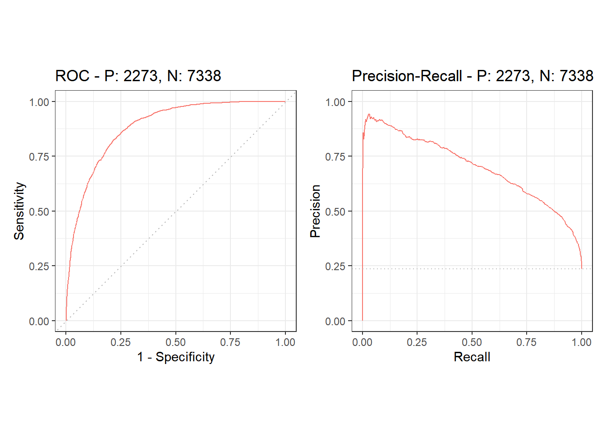

# m6APrediction

m6APrediction is an R package for predicting m6A site scores and
classifications from input features using a fitted random forest model.
It supports predictions for a single site or multiple sites.

## Installation

Install the package from GitHub:

```r
install.packages("remotes")
remotes::install_github("Leo33550336/m6APrediction")
```

## Predict multiple sites

The package includes an example feature table and a fitted model.

```r
library(m6APrediction)

ml_fit <- readRDS(system.file(
  "extdata", "rf_fit.rds",
  package = "m6APrediction", mustWork = TRUE
))

example_df <- read.csv(system.file(
  "extdata", "m6A_input_example.csv",
  package = "m6APrediction", mustWork = TRUE
))

batch_result <- prediction_multiple(
  ml_fit, head(example_df, 3), positive_threshold = 0.6
)

batch_result[, c("predicted_m6A_prob", "predicted_m6A_status")]
```

## Predict one site

```r
library(m6APrediction)

ml_fit <- readRDS(system.file(
  "extdata", "rf_fit.rds",
  package = "m6APrediction", mustWork = TRUE
))

prediction_single(
  ml_fit, gc_content = 0.6, RNA_type = "mRNA",
  RNA_region = "CDS", exon_length = 12,
  distance_to_junction = 5,
  evolutionary_conservation = 0.8, DNA_5mer = "GGACA"
)
```

## Interpreting the output

The functions return a predicted score and a classification. A score
strictly greater than `positive_threshold` is classified as `Positive`;
otherwise it is classified as `Negative`. The default threshold is 0.5.

The bundled example data demonstrate how to use the package. They should
not be treated as an independent evaluation of model performance.

## Function documentation

After installing and loading the package, use:

```r
?prediction_multiple
?prediction_single
```

## Scientific context: earlier coursework evaluation



The Practical 3 random forest achieved an AUROC of 0.885 and an
AUPRC of 0.700 on its held-out test set, containing 2,273 positive
and 7,338 negative sites. The positive-class prevalence was 0.236.

These results illustrate the potential of feature-based m6A prediction.
They describe the earlier Practical 3 model and are not an independent
validation of the model bundled with this package.
